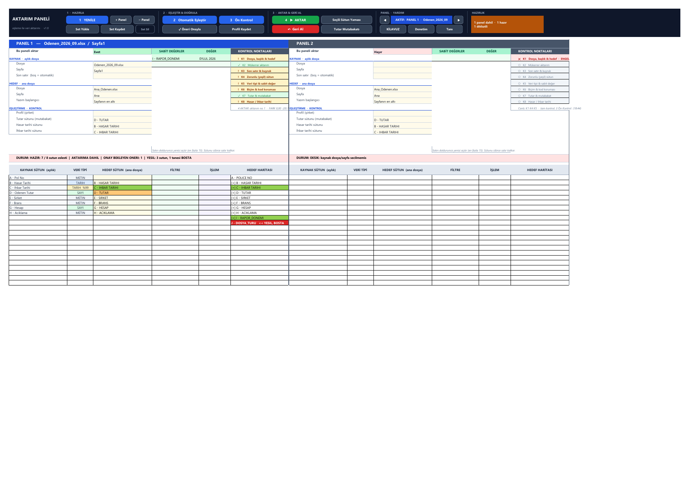
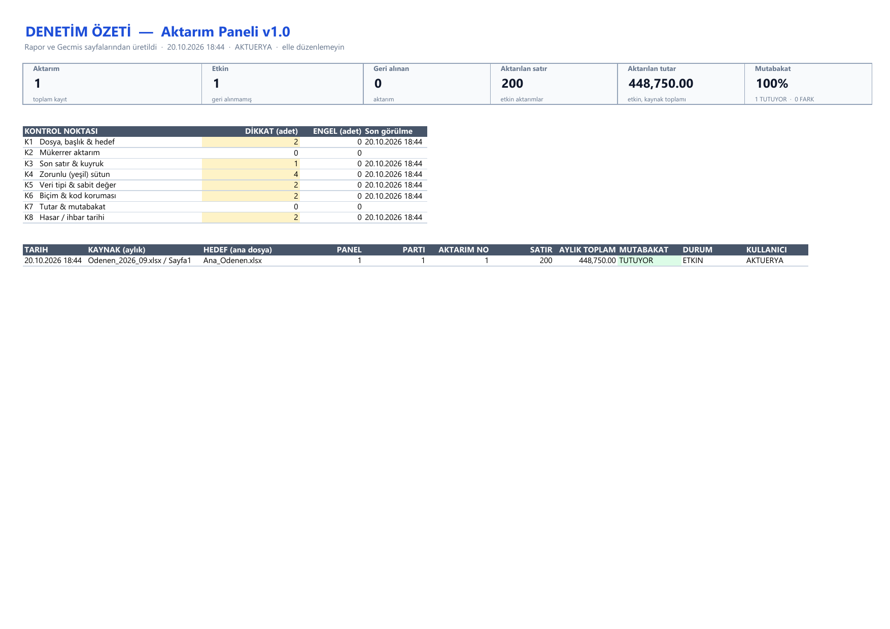

# Aktarım Paneli

> **v1.1 "Kurumsal Sürüm" — source complete, not yet released.**
> All v1.1 work is in `src/` and passes the portable gates (ASCII, palette, type
> scale, contrast, MsgBox budget, VBA lint, LibreOffice compile smoke test).
> Excel compilation, the E2E/enterprise suites, migration runs, `perf.py` and the
> screenshots need Windows + Excel and **have not been run yet**; the downloads and
> screenshots below are still v1.0. Status per requirement:
> [plan/V1.1_SONUC.md](plan/V1.1_SONUC.md).

**Column-mapped, audited data transfer for actuarial closing in Excel.**

Every month, claim files (*Ödenen*, *Muallak*, …) have to be appended to cumulative
master workbooks of 870 000+ rows. Their column names and orders never quite match.
Aktarım Paneli maps the columns, checks the data against **fourteen named actuarial
control points**, writes it, reconciles amounts, row counts and per-category totals
to the cent, logs every decision with source lineage, and can undo the whole batch safely.
An **Analiz** sheet summarises the monthly or master data by any dimension.

It is pure Excel VBA: no add-ins, no ActiveX and no `Scripting` runtime. It runs on
locked-down Citrix desktops and on Mac Excel.



**At a glance (v1.1)**

- **1 → 2 → 3 → 4 ribbon with state:** done steps carry ✓, only the *next* step is filled,
  AKTAR stays passive while anything is ENGEL; Analiz · Denetim · Diğer ▾ are secondary,
  Geri Al is a red ghost button in its own group. Eight visible buttons; Ctrl+Shift+1…4.
- **K1–K14 scorecard** per panel with a badge (`11 ✓ · 2 ! · 0 ✕`) and a **data-quality score**
  (0–100): completeness 30 %, validity 25 %, uniqueness 20 %, reasonableness 15 %, reconciliation 10 %.
- **Reconciliation that proves completeness:** 4-way on the main amount, 3-way on up to
  eight numeric columns, row-count invariant and per-category (K13) totals read back from the master.
- **Integrity:** typed CRC32 over every written cell (undo), source fingerprint between
  Ön Kontrol and AKTAR (K14), content-based duplicate detection (K2), master-file lock.
- **Denetim:** numeric KPIs, K1–K14 counts and findings-per-run bars, 12-month trend,
  process metrics (first-pass yield, override and undo rates, step durations), non-default thresholds. One A4 page.
- **Analiz:** request card, only the requested columns are read, eight measures, pivot,
  native chart, three-point commentary, templates A1–A9 (incl. chain-ladder development
  factors and frequency/severity decomposition), user templates.
- **Ayarlar:** every threshold editable with a documented default; mandatory columns as metadata.
- **No modal noise:** information goes to a notification strip; 30 dialogs remain, all decisions or data-safety alerts.

**Download:** <https://furkzel.github.io/pnL/> offers the ready workbook (`.xlsm`),
a macro-free copy (`.xlsx`) and the macros alone (`.zip`, plain text), for networks that
block macro files. SHA-256 checksums are on the page.

---

## Contents
1. [The 1 → 2 → 3 → 4 workflow](#the-1--2--3--4-workflow)
2. [The fourteen actuarial control points (K1–K14)](#the-fourteen-actuarial-control-points-k1k14)
3. [ASOP 23 data-quality alignment](#asop-23-data-quality-alignment)
4. [The Panel screen](#the-panel-screen)
5. [Transfer engine](#transfer-engine)
6. [Audit trail: Rapor, Gecmis, Denetim](#audit-trail-rapor-gecmis-denetim)
7. [Install, upgrade, release](#install-upgrade-release)
8. [Architecture](#architecture)
9. [Developer workflow and CLI](#developer-workflow-and-cli)
10. [Verification and performance](#verification-and-performance)
11. [Rules for maintainers](#rules-for-maintainers)
12. [Limitations and version history](#limitations-and-version-history)

---

## The 1 → 2 → 3 → 4 workflow

The frozen ribbon at the top of **Panel** carries four numbered primary buttons. A new
analyst follows the numbers:

| Step | Button | What happens |
|---|---|---|
| **1** | **YENİLE** | Reads open files, sheets and headers. Restores mappings, applies the company profile, auto-selects the *Tutar / Hasar / İhbar / Hasar no / Branş* columns when the match is unambiguous, and refreshes the live checks K1, K4 and K5. |
| **2** | **Otomatik Eşleştir** | Pass 1 matches identical names, using occurrence order for duplicate names. Pass 2 suggests similar names (Levenshtein ≥ 70 %), discarding candidates whose data type conflicts. Suggestions turn violet and carry a note with the top three candidates. |
| **3** | **Ön Kontrol** | A dry run of the full transfer that writes nothing. It fills the K1–K14 scorecard and the quality score, puts a one-line summary on the notification strip, and writes every finding, the metrics and the source lineage to Rapor. |
| **4** | **AKTAR** | Transfers every panel marked "Bu paneli aktar = Evet" as one batch (*parti*), under a master-file lock. Each panel is confirmed, written, and reconciled (amounts, row count, categories). Passive while any included panel is ENGEL. |

Only the **next** step is filled (brand blue); finished steps carry ✓; later steps are
passive. Secondary, outlined: **Analiz**, **Denetim**, **Diğer ▾** (+ Panel, Panel kaldır,
Önceki/Sonraki panel, Set yükle/kaydet/sil, Öneri onayla, Profil kaydet, Seçili sütun
yaması, Tutar mutabakatı, Ayarlar, Kılavuz, Tanı). **↶ Geri Al** is a red ghost button in
its own group at the right. Ctrl+Shift+1…4 run the steps while this workbook is active.

The **HAZIRLIK** pill ("2 / 3 panel hazır · 1 dikkatli (!)") summarises the scorecards of
all included panels: green when the batch is ready for AKTAR, amber when a panel still
needs Ön Kontrol or has DİKKAT items, red on any ENGEL. Click it for the per-panel table.
The **notification strip** next to it shows the latest message; click for the last five,
click again to jump to the Rapor row.

---

## The fourteen actuarial control points (K1–K14)

Every finding is tagged `[Kn]`, raises that point on the panel scorecard, and is written to
Rapor in full with a `KONTROL NOKTASI` value such as `K8 DIKKAT`.

Statuses: **✓ OK** · **! DİKKAT** (read and confirm; the default button is *No*) ·
**✕ ENGEL** (nothing is written) · **○** waiting for Ön Kontrol · **–** not applicable.

| | Control point | What is checked | Level |
|---|---|---|---|
| **K1** | Dosya, başlık & hedef | File/sheet reachable, master not read-only, **master not locked by another user**, headers where expected, no two sources on one target, no pending suggestion, valid target range | ENGEL / DİKKAT |
| **K2** | Mükerrer aktarım | Same file/sheet **or same content trace** (rows + amount + key CRC) already active in this master — survives renaming | DİKKAT (AKTAR asks) |
| **K3** | Son satır & kuyruk | Majority last row, footer block separated by blank rows; previewed | DİKKAT |
| **K4** | Zorunlu sütun | Unmapped mandatory column and blank cells in mapped mandatory columns (fill %). Mandatory = Ayarlar list, else green header | DİKKAT |
| **K5** | Veri tipi & sabit değer | Type conflict; type from a stratified sample (head, middle, tail, seeded random windows) | DİKKAT |
| **K6** | Biçim & kod koruması | Leading zeros, 16+ digits, `=`-text, `#####`, more than two decimals in amounts | DİKKAT |
| **K7** | Tutar & mutabakat | Non-numeric/blank/negative amounts; 4-way main amount, 3-way extra numeric columns, row count and numeric-cell count, Currency arithmetic | DİKKAT / ENGEL |
| **K8** | Hasar & ihbar tarihi | İhbar before hasar, blank, unparseable, text dates | DİKKAT |
| **K9** | Anahtar tekilliği | Claim key (+amount +loss date) repeated; **exact copy rows** (ENGEL, configurable); stratified sample found in the master tail | DİKKAT / ENGEL |
| **K10** | Dönem tutarlılığı | Dates after the reporting-period end; outside 1990 … period end + 12 months | DİKKAT |
| **K11** | Makullük | Row and amount z-scores against the same target's last 12 months; large claims; Benford first-digit MAD | DİKKAT |
| **K12** | Şema & kod kayması | New/vanished columns vs profile and last transfer; category codes never seen in the master tail or gone since last month | DİKKAT |
| **K13** | Katmanlı mutabakat | Per category: count and every reconciled amount, source vs rows read back from the master | ENGEL |
| **K14** | Kaynak bütünlüğü & soy | Source changed between Ön Kontrol and AKTAR (TOCTOU) → ENGEL; unsaved source → DİKKAT; path, size, timestamp, fingerprints to Rapor | ENGEL / DİKKAT |

K1, K4, K5 update live; the others need the data and are evaluated by Ön Kontrol and AKTAR.

**Actuarial assumptions (stated, configurable in Ayarlar):** period end defaults to the end of
the previous month; the K9 master check is DİKKAT only because snapshot files (Muallak) legitimately
repeat key + amount unless a period constant is mapped; K11 history is the same target *and*
panel, active transfers, last 12 calendar months excluding the current one, at least 3 months;
large-claim default 10 000 000; Benford needs ≥ 1 000 amounts ≥ 10 and flags MAD > 0.015;
K13 counts text-stored numbers in the source but not in the master, exactly like K7.

## ASOP 23 data-quality alignment

ASOP 23 (*Data Quality*) asks the actuary to judge whether data is appropriate,
reasonably complete and consistent, to review it for reasonableness, and to disclose
its limitations. The tool **supports** those steps; it does not replace the actuary's
judgment, and running it does not by itself establish compliance.

| ASOP 23 expectation | Where the tool supports it |
|---|---|
| Data appropriate for the purpose; correct fields used | K1 header re-validation and duplicate-target ENGEL; K5 type conflicts; orange suggestions must be approved |
| Comprehensiveness / completeness | K3 tail analysis (nothing silently dropped or added); K4 blank mandatory cells; K7 blank and non-numeric amounts |
| Reasonableness and consistency review | K5, K8 date logic; K7 four-way reconciliation to 0,00; K2 duplicate source detection |
| Integrity of data during processing | K6 format guard; formula row shifting; typed CRC32 undo fingerprint; K13 read-back; K14 source fingerprint |
| Documentation and disclosure of limitations | Rapor: every item and decision tagged K1–K14, lineage, metrics and quality score; Gecmis: column-level ledger; Denetim: one-page summary with non-default thresholds |

---

## The Panel screen

```
┌ ribbon (frozen) ─ [✓ 1 Yenile][✓ 2 Eşleştir][■ 3 Ön Kontrol][4 AKTAR] │ Analiz · Denetim · Diğer ▾ ║ ↶ Geri Al ┐
│                   [HAZIRLIK  2 / 3 panel hazır · 1 dikkatli (!)]      │ ✓ 14:02  On Kontrol PANEL 1 · 200 satır …  │
├ PANEL k ─ file / sheet ─────────────────────────────────────────────────────────────────────────────────────────┤
│ settings c..c+2, rows 8-24             │ SABİT DEĞERLER c+3/c+4 │ KONTROL NOKTALARI c+5  11 ✓ · 2 ! · 0 ✕     │
│  Bu paneli aktar · KAYNAK · HEDEF ·    │  up to 15 fixed values │  K1 … K14                                   │
│  Profil · Tutar · Hasar · İhbar ·      │                        │  Veri kalitesi 97 / 100                     │
│  Anahtar · Kırılım · Dönem sonu        │                        │  last check note                            │
├ DURUM: one line, colour = meaning of the text ────────────────────────────────────────────────────────────────┤
│ KAYNAK SÜTUN │ VERİ TİPİ │ ✓ HEDEF SÜTUN │ FİLTRE │ ⇆ İŞLEM │ ⇆ HEDEF HARİTASI (read-only)                      │
└──────────────────────────────────────────────────────────────────────────────────────────────────────────────┘
```

- Up to 10 blocks side by side. A removed block is hidden, not deleted, so panel
  numbers and saved sets never shift.
- Columns you type into (HEDEF, FİLTRE, İŞLEM) sit together. The read-only map of
  every master column, coloured exactly like the master's headers, sits at the right
  edge.
- Hover over the table and card headers for notes on the filter syntax, İŞLEM, the type
  colours, the map and the control points.
- **Colour has one meaning:** green = passed, amber = DİKKAT, red = ENGEL, violet = pending
  suggestion, blue = brand / next step. Zone backgrounds are neutral; mandatory columns are
  marked with ● and a left rule, "Bu paneli aktar" with ● Evet / ○ Hayır (number format,
  the stored value is unchanged).

**Double-click shortcuts**

| Double-click on… | Effect |
|---|---|
| "Bu paneli aktar" value | Evet ↔ Hayır, with the colour and HAZIRLIK updated instantly |
| an orange suggestion in HEDEF SÜTUN | approves it |
| an İŞLEM cell | toggles SEÇ (keeps FORMÜL) |
| an unfilled column in HEDEF HARİTASI (e.g. red `<< YESIL, BOSTA`) | adds it to SABİT DEĞERLER and jumps to its value cell |

---

## Transfer engine

| Capability | Behaviour |
|---|---|
| Write modes | *Sayfanın en altı* (normal); *Sütunun kendi sonu*; *Geri alınan aralığa* (refills an undone gap, inserting rows and shifting the Gecmis/Rapor ledgers if the new data is longer) |
| Filters | `AXA` · `AXA, ALLIANZ` · `AX*` `A?A` · `>100` `<=500` `>=01.01.2026` · `<>IPTAL` · `BOS` / `DOLU`. If a value itself contains a comma and exists verbatim in the column, it is treated as one value |
| Fixed values | Up to 15 per panel. The value dropdown is fed from the last 50 000 master rows, with a per-refresh cache |
| Format guard (K6) | Strings Excel would corrupt (`0004821` → 4821, 19-digit IDs → `1.23E+18`, `=…` → formula) are written as text. Everything else behaves as in v33. New rows inherit the number format of the row above |
| Formula transfer | `FORMÜL` columns shift relative **row** references and keep column letters: `=B5*C5` becomes `=B870005*C870005` |
| Seçili Sütun Yaması | Columns marked SEÇ overwrite the rows of the last active transfer of the same source. Old values go to the hidden `Yedek` sheet and Geri Al restores them |
| Geri Al | Two phases. **Phase 1** checks every record: file open, not read-only, header unchanged, backup present, and the **fingerprint** (count, sum, first and last value) of the written range. Rows inserted above the block are detected and the user is warned before anything is cleared. **Phase 2** clears or restores in reverse order |
| Reconciliation (K7, K13) | Main amount: source read = target written and master Δ = written − overwritten. Every other mapped numeric column (up to 8): source = written. Row count: last used row moves exactly as expected and numeric-cell counts match. Per category (K13): counts and amounts read back from the master. Currency arithmetic, tolerance in Ayarlar (0,005). Tutar Mutabakatı re-checks **every** transfer of the last batch later |
| Fingerprint | v1.1 `V;C2=` typed CRC-32 of every written cell (16-bit table, doubles via `LSet`; equals zlib). v1.0 `V;n=` and v1.1-dev `V;CRC32=` records are still verified with their own algorithm |
| Lock (M12) | `<master>.aplock` (user, machine, time) while writing; another user's fresh lock is ENGEL, a stale one (Ayarlar) is taken over; cloud paths cannot be locked and say so in the lineage |
| Backup retention (M14) | Backups of the last N batches (Ayarlar, 20) are kept; older ones are cleared, their Gecmis row reads `SILINDI:<ref>` and Geri Al explains why it refuses |

---

## Audit trail: Rapor, Gecmis, Denetim

- **Rapor** is the human-readable event log. It records every transfer, every DİKKAT
  and ENGEL item **unshortened in its own row**, each user decision, undo, profile and
  set change, and each reconciliation. The `KONTROL NOKTASI` column (`K1 … K8` plus
  level) makes it filterable. Reconciliation cells are green when TUTUYOR and red when
  FARK VAR.
- **Gecmis** is the undo ledger: one row per written column, with range, status,
  fingerprint and backup reference. Don't edit it by hand.
- **Rapor** columns 28–36 (v1.1): source path, size, modified time, source fingerprint,
  content trace, duration (ms), row-count reconciliation, quality score and a
  `name=value;` metrics string (completeness, validity, uniqueness, z-scores, Benford MAD,
  large claims, reconciled columns, categories, findings, duration).
- **Denetim** is a one-page manager and auditor summary, regenerated after every
  transfer and undo: numeric KPI cards (transfers, active, rows, amount, reconciliation
  rate, average quality), K1–K14 DİKKAT/ENGEL counts with findings-per-run bars and last
  seen, a 12-month trend chart, process metrics (first-pass yield, override rate, undo
  rate, average Ön Kontrol / AKTAR / Yenile time, file and backup size), thresholds that
  differ from their defaults, and the last 10 transfers.
- **Analiz** (new): pick a source (monthly file, master, last batch), a row and an optional
  column dimension, a measure (count, sum, mean, min, max, distinct, P50, P95), a filter in
  the Panel syntax and a period. Date dimensions group by month. Templates: A1 profile, A2
  month-on-month z-score, A3 category × company, A4 development triangle with
  volume-weighted chain-ladder factors (no tail assumed), A5 reporting delay, A6 large-claim
  top 20, A7 transfer impact, A8 control-point trend, A9 frequency/severity decomposition.
- **Ayarlar** (new): all thresholds with code, value, default and explanation; the
  mandatory-columns table overrides header colours.



---

## Install, upgrade, release

| Goal | Command |
|---|---|
| Build a fresh workbook | `python tools/build.py --new dist/AktarimPaneli_v1.1.xlsm` |
| Upgrade a v33, v34 or v1.0 workbook (works on a **copy**; the input is never modified) | `python tools/build.py --upgrade old.xlsm --out new.xlsm` |
| Build the 3 download packages, `SHA256SUMS.txt`, and update the page's checksum table | `python tools/release.py --version v1.1` |

`SifirdanKur` is the one-click bootstrapper. It keeps Rapor, Gecmis, Profiller and
Setler, and migrates the panel:
- **v33** (7-column blocks) → v1.1
- **v34** (map in the middle) → v1.1, moving FİLTRE and İŞLEM left and the map right
- **v1.0** (and its earlier name v35) → v1.1: same table and setting offsets; the three new
  settings (rows 22–24) start empty, the scorecard gains K9–K14, Rapor gains columns 28–36,
  Setler 13–15; legacy fingerprints keep undoing v1.0 transfers

Settings, fixed values, filters, flags, mappings and pending suggestions are all kept.
It removes the old v33 analytics sheets and names, and rebuilds Kılavuz, Geliştirici
and Denetim.

**Manual install, without Python:** open the macro-free `.xlsx` and save it as `.xlsm`.
Then import `Sozluk.cls` and every `.bas` file in `src/`, and paste the Panel and ThisWorkbook code
(`KURULUM.txt` in the zip). Run *Debug › Compile*, then `Alt+F8 › SifirdanKur`.

Requirements for the tools: Windows, Excel, Python 3.10+ with `pywin32`, and *Trust
access to the VBA project object model* enabled. `screenshot.py` also needs `pdftoppm`.
All tools start their **own invisible Excel instance**, and a watchdog answers
MsgBox/InputBox dialogs, so automation never hangs and never touches your open
workbooks.

---

## Architecture

```
src/                       single source of truth, 100 % printable ASCII
  Sozluk.cls               native dictionary (Collection-backed), no Scripting.Dictionary
  M01_Ayarlar.bas          constants: layout offsets, Listeler/Rapor/Gecmis/Profiller/Setler
                           columns, control-point status levels, colour palette, globals
  M02_Yardimci.bas         BH/Normalize/TR (Turkish-safe), SutunOku (1-row + overflow safe),
                           DosyaBul/SayfaBul, data types, BaslikDogrula, MaddeKisalt,
                           AlanTemizle, EkranKilitle/EkranAc
  M03_Panel.bas            block geometry, ribbon, sticky navigation, cards, add/remove panel
  M04_Yenile.bas           Yenile (single-pass sampling), menus, DURUM, fixed values,
                           target map, type column, auto-detection, change & double-click router
  M05_Eslestirme.bas       two-pass auto-mapping, suggestions, learning profiles, sets
  M06_Aktarim.bas          staged transfer engine (AktarimPlani), K1–K14 (KEkle), multi-column,
                           row-count and layered reconciliation, lineage, metrics, quality score
  M07_Kayit.bas            two-phase undo with fingerprint and backup, Gecmis, Rapor,
                           batch-aware Tutar Mutabakatı
  M08_Kurulum.bas          SifirdanKur, PaneliYenidenKur (v33/v34 migration), PanelKur, Tani
  M09_Kilavuz.bas          accordion guide (Kılavuz) and developer handoff sheet (Geliştirici)
  M10_Denetim.bas          K1–K14 names, scorecard + badge + quality, HAZIRLIK, Denetim sheet
  M11_Analiz.bas           Analiz sheet: request card, grouping, chart, commentary, A1–A9
  M12_Butunluk.bas         typed CRC-32 (16-bit table) for fingerprints and traces
  M13_Koruma.bas           UserInterfaceOnly protection, print areas
  M14_Filtre.bas           shared filter engine (Panel + Analiz)
  M15_Esik.bas             Ayarlar sheet: thresholds with defaults, mandatory-column metadata
  M16_Bellek.bas           state store, notification strip, master-file lock
  Panel.cls                Panel sheet events (Change, SelectionChange, Activate, BeforeDoubleClick)
  ThisWorkbook.cls         Workbook_Open/Activate/Deactivate: state repair, protection, shortcuts;
                           SheetChange routes the Analiz request card
tools/                     xlauto.py (COM + dialog watchdog), build, release, export,
                           test_e2e, test_enterprise, screenshot, perf (Windows + Excel)
                           source_checks, vba_lint, lo_compile, test_* (portable, CI)
docs/                      GitHub Pages download page and screenshots
```

---

## Developer workflow and CLI

```bash
python tools/build.py --check          # ASCII, palette, type scale, contrast, MsgBox <= 30, VBA lint
python tools/vba_lint.py               # undeclared names, arity, Private calls, ambiguous/reserved names
python tools/lo_compile.py             # LibreOffice Basic syntax smoke test, per procedure (needs soffice)
python -m unittest discover -s tools -p 'test_source_checks.py'   # + test_vba_lint.py, test_karma_model.py
# Windows + Excel + pywin32:
python tools/build.py --new dist/AktarimPaneli_v1.1.xlsm
python tools/test_e2e.py --panel dist/AktarimPaneli_v1.1.xlsm [--v33 v33.xlsm]
python tools/test_enterprise.py --panel dist/AktarimPaneli_v1.1.xlsm
python tools/perf.py --rows 200000 --master 300000 --cols 30 --panels 3
python tools/perf.py --master 870000 --analiz
python tools/screenshot.py
python tools/export.py dist/AktarimPaneli_v1.1.xlsm
python tools/release.py --version v1.1
```

`build.py` refuses a source that fails the portable gates, imports the modules, injects
the two document modules, runs *Debug › Compile* (a compile error fails the build and is
printed) and runs `SifirdanKur`.

**Without Excel** three gates approximate the compiler: `source_checks` (house rules),
`vba_lint` (Option Explicit, call arity, Private/ambiguous/reserved names; the list of VBA
and Excel names it accepts was derived from the v1.0 source that compiled in Excel and is
extended only by review) and `lo_compile` (LibreOffice's Basic compiler in VBA mode,
procedure by procedure; a handful of Excel-only constructs are marked `' LO-atla`). They
caught real defects during v1.1 (a variable named `sEt`, a wrong argument count), but they
are **not** Excel's compiler: the first Windows build is still a mandatory gate.

---

## Verification and performance

`tools/test_e2e.py` drives the built workbook through Excel exactly as a user would.
Cell edits fire the real sheet events, and every dialog and notification is answered and
asserted. **v1.0: 154 / 154 passed. v1.1: 206 check calls written (the 154 kept, a few updated
for changed behaviour, see plan/V1.1_SONUC.md); not yet run.** Coverage:

- **Mapping and checks:** auto-mapping and profiles; dry run with every K1–K14 finding;
  live scorecard; tagged Rapor rows; filters.
- **Transfer and undo:** format guard; formula shift; four-way reconciliation; undo;
  fingerprint detection; patch with backup restore; gap mode with row insertion.
- **Panels and batches:** sets; add/remove panels; two-panel batch reconciliation and
  tamper detection.
- **UI:** double-click shortcuts; HAZIRLIK; the Denetim sheet.
- **Migration:** a real v33 workbook, a real v34 workbook and (v1.1) a real v1.0 workbook
  built from the release commit, including undo of a v1.0 transfer after the upgrade.
- **v1.1:** K9–K14, editable thresholds, lock, multi/row-count/K13 reconciliation, lineage,
  K2 content trace, Denetim, Analiz templates, protection of the new sheets.

`tools/perf.py`, on a 200 000 × 30 source and a 300 000 × 30 master, 3 panels
(v1.0 measurements; v1.1 has not been measured yet):

| Step | v1.0 | Previous release (same machine, same run) |
|---|---:|---:|
| Yenile (3 panels) | 8.2 s | 7.5 s |
| Otomatik Eslestir | 0.8 s | 0.6 s |
| On Kontrol | **5.8 s** | 26.0 s |
| Aktar (200 000 rows × 30 cols, incl. dialogs) | **14.6 s** | 33.3 s |
| Geri Al | 3.4 s | 3.6 s |

Reconciliation: FARK 0,00 (TUTUYOR) in both. Timings depend on machine load: run
both builds back to back when you compare. The On Kontrol and Aktar gains come
from skipping the format-guard check for text that starts with a letter, inline
in the hot loops (about 5 million calls fewer per run).

---

## Rules for maintainers

1. VBA source must be **100 % printable ASCII** (`build.py` enforces this). Text in cells and shapes goes through `TR("#s#i#g")`; MsgBox text stays ASCII.
2. Compare with `BH()` / `Normalize()`, never raw `UCase`/`LCase`. On Turkish Windows, `UCase("i")` returns `İ`.
3. No `Scripting.Dictionary`, `RegExp` or ActiveX: use `Sozluk`, `Collection`, arrays and shapes. Native `ChartObjects` are fine.
4. Read big sheets **column by column** with `SutunOku`. It returns 2-D arrays even for one row, and falls back to `.Value2` on overflow error 6. Never use `Application.Transpose`.
5. Never call `ws.Cells.Clear` on a sheet with dropdowns; use `AlanTemizle`.
6. Every entry macro pairs `EkranKilitle` with `EkranAc`. Save `Err` before `EkranAc`, because `On Error` resets it.
7. Layout lives only in `M01_Ayarlar`. If the block layout changes, bump `DUZEN_DEGERI` and teach `M08_Kurulum.BlokOku` the old offsets (see the v34 and v1.0 branches).
8. A new check is an `KEkle p, n, engelMi, "..."` call in M06 (n = 1…14). It is tagged automatically, raises the scorecard, and reaches Rapor, Denetim and HAZIRLIK. A threshold is an `EsikKod` with an `ESV_` default in M01 and a row in Ayarlar, read with `Esik()` — no magic numbers.
9. Colour only through `Palet()` (tokens + role aliases, M01); font sizes only through `YZ_*`; information through `Bildir`, dialogs only for decisions and data-safety alerts (≤ 30, gated).
10. After any change, run `build.py --check`, `vba_lint`, `lo_compile`; on Windows `build.py`, `test_e2e.py`, `test_enterprise.py`. If a fix was made in the VBA editor, run `export.py` and review the diff.

---

## Limitations and version history

- Headers must be on row 1.
- The K9 master check samples key + amount (+ fixed values) in the master tail; it is
  evidence, not a full anti-join of 870 000 rows.
- The K14 source fingerprint covers the key, amount, date and category columns (full CRC)
  and the row count; edits in other source columns between Ön Kontrol and AKTAR are not in
  that trace (the undo fingerprint does cover every written column).
- The master-file lock is a sidecar file; it cannot be created on cloud (https) paths.
- Mandatory columns fall back to header colour when Ayarlar has no list for the sheet.
- Filter dropdowns read the first 10 000 rows (filters apply to all rows).
- CRC-32 detects accidental change; it is not a cryptographic signature. Sheet protection
  prevents accidental edits; it is not access control.
- ASOP 23 alignment describes supporting evidence, not a compliance certification.

| Version | Highlights |
|---|---|
| v1.1 (source) | Enterprise release, source complete, Excel validation pending: K9–K14, multi-column / row-count / layered reconciliation, typed CRC32, lineage and TOCTOU, lock, backup retention, Ayarlar thresholds, quality score, Analiz A1–A9, semantic palette and type scale, state-aware ribbon, notification strip (30 dialogs), Denetim redesign, protection, print setup, v1.0 → v1.1 migration, portable lint and LibreOffice compile gates. See plan/V1.1_SONUC.md |
| v33 | Monolithic Module1/2/3 with an analytics add-on |
| v34 | Modular `src/`, build/test tooling, format guard, fingerprinted undo, patch mode, filters, ~9× faster Yenile |
| v1.0 | K1–K8 control points with live scorecard and tagged audit rows; Denetim sheet; HAZIRLIK; batch reconciliation; amount, green-cell and fixed-value checks; editable columns grouped with the map moved right; card layout; double-click shortcuts; auto-detected control columns; v33/v34/v35 → v1.0 migration; supersedes the release first published as v35 |
