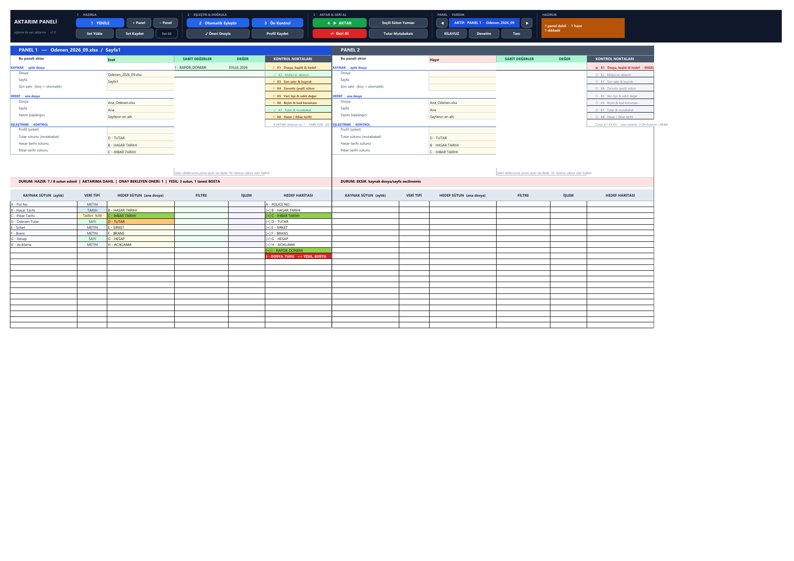
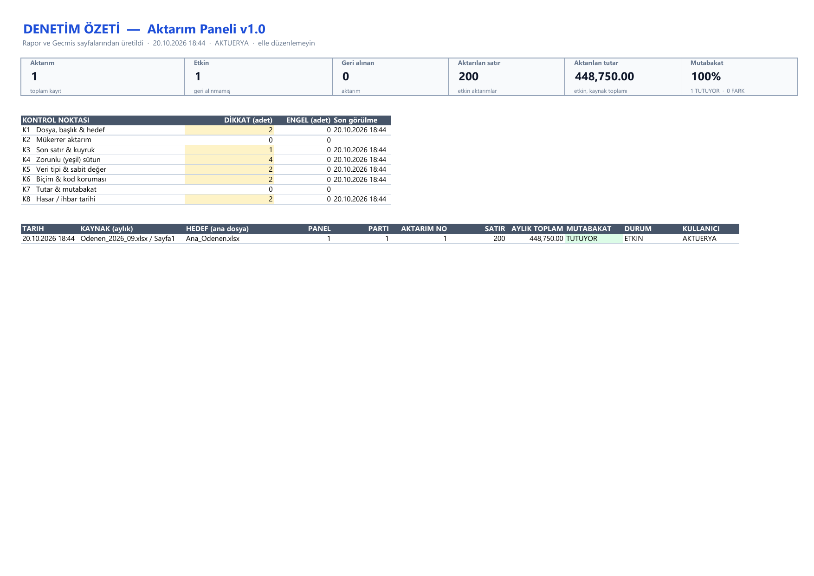

# Aktarım Paneli v1.0

**Column-mapped, audited data transfer for actuarial closing in Excel.**

Every month, claim files (*Ödenen*, *Muallak*, …) have to be appended to cumulative
master workbooks of 870 000+ rows. Their column names and orders never quite match.
Aktarım Paneli maps the columns, checks the data against **eight named actuarial
control points**, writes it, reconciles the amounts to the cent, logs every decision,
and can undo the whole batch safely.

It is pure Excel VBA: no add-ins, no ActiveX and no `Scripting` runtime. It runs on
locked-down Citrix desktops and on Mac Excel.



**At a glance**

- **1 → 2 → 3 → 4 guided workflow:** Yenile, Otomatik Eşleştir, Ön Kontrol, Aktar.
- **Live K1–K8 scorecard** per panel, aligned with ASOP 23; every finding is written to Rapor in full.
- **Denetim sheet:** executive summary of transfers, reconciliation and control-point statistics.
- **HAZIRLIK indicator:** how many panels are ready, flagged or blocked, at a glance.
- **Double-click shortcuts** for DAHİL, ÖNERİ, İŞLEM and map → fixed value.
- **Format and leading-zero protection:** codes like `0004821` and 16-digit numbers stay text.
- **4-way amount reconciliation** (FARK 0,00) after every transfer.
- **2-phase atomic undo with fingerprinting:** hand-edited cells are detected before anything is rolled back.

**Download:** <https://furkzel.github.io/pnL/> offers the ready workbook (`.xlsm`),
a macro-free copy (`.xlsx`) and the macros alone (`.zip`, plain text), for networks that
block macro files. SHA-256 checksums are on the page.

---

## Contents
1. [The 1 → 2 → 3 → 4 workflow](#the-1--2--3--4-workflow)
2. [The eight actuarial control points (K1–K8)](#the-eight-actuarial-control-points-k1k8)
3. [ASOP 23 data-quality alignment](#asop-23-data-quality-alignment)
4. [The Panel screen](#the-panel-screen)
5. [Transfer engine](#transfer-engine)
6. [Audit trail: Rapor, Gecmis, Denetim](#audit-trail-rapor-gecmis-denetim)
7. [Install, upgrade, release](#install-upgrade-release)
8. [Architecture](#architecture)
9. [Developer workflow and CLI](#developer-workflow-and-cli)
10. [Verification and performance](#verification-and-performance)
11. [Rules for maintainers](#rules-for-maintainers)
12. [Limitations and version history](#limitations-and-version-history)

---

## The 1 → 2 → 3 → 4 workflow

The frozen ribbon at the top of **Panel** carries four numbered primary buttons. A new
analyst follows the numbers:

| Step | Button | What happens |
|---|---|---|
| **1** | **YENİLE** | Reads open files, sheets and headers. Restores mappings, applies the company profile, auto-selects the *Tutar / Hasar / İhbar* columns when the match is unambiguous, and refreshes the live checks K1, K4 and K5. |
| **2** | **Otomatik Eşleştir** | Pass 1 matches identical names, using occurrence order for duplicate names. Pass 2 suggests similar names (Levenshtein ≥ 70 %), discarding candidates whose data type conflicts. Suggestions turn orange and carry a note with the top three candidates. |
| **3** | **Ön Kontrol** | A dry run of the full transfer that writes nothing. It fills the K1–K8 scorecard, shows an executive summary, and writes every finding to Rapor. |
| **4** | **▶ AKTAR** | Transfers every panel marked "Bu paneli aktar = Evet" as one batch (*parti*). Each panel is confirmed, then written, then reconciled with four totals. |

Secondary actions sit next to them:
- **Panels and sets:** + Panel / − Panel, Set Yükle / Kaydet / Sil
- **Mapping:** ✓ Öneri Onayla (context-aware), Profil Kaydet
- **Correction and checks:** Seçili Sütun Yaması, ↶ Geri Al, Tutar Mutabakatı
- **Help and navigation:** Kılavuz, Denetim, Tanı, and ◀ AKTİF: PANEL k ▶

The **HAZIRLIK** pill summarises the scorecards of all included panels. It is green
when the batch is ready for AKTAR, amber when a panel still needs Ön Kontrol or has
DİKKAT items, and red on any ENGEL. Click it for the per-panel table.

---

## The eight actuarial control points (K1–K8)

Every finding is tagged `[Kn]` in the dialogs, raises that point's status on the panel
scorecard, and is written to Rapor in full with a `KONTROL NOKTASI` value such as
`K8 DIKKAT`.

Statuses: **✓ OK** · **! DİKKAT** (read and confirm; the default button is *No*) ·
**✕ ENGEL** (nothing is written) · **○** waiting for Ön Kontrol · **–** not applicable.

| | Control point | What is checked | Typical result |
|---|---|---|---|
| **K1** | Dosya, başlık & hedef | File and sheet reachable; master not read-only; every mapped and fixed header still where the panel expects it (or found by name); no two sources writing to one target; no pending suggestions; target range valid (patch range, undone gap, row limit) | ENGEL / DİKKAT |
| **K2** | Mükerrer aktarım | The same monthly file/sheet is already active in this master (not undone) | DİKKAT (AKTAR asks) |
| **K3** | Son satır & kuyruk | Majority last row vs. latest row; footer block separated by blank rows (grand totals). The rows that would be excluded are **previewed** | DİKKAT, user decides |
| **K4** | Zorunlu (yeşil) sütun | Green (mandatory) master columns that stay unmapped, and **blank cells inside mapped green columns**, with sample rows | DİKKAT |
| **K5** | Veri tipi & sabit değer | Source vs. target type conflict (TARİH/SAYI/METİN); fixed value vs. target type (e.g. `EYLUL 2026` into a date column) | DİKKAT |
| **K6** | Biçim & kod koruması | Leading-zero codes, 16+ digit IDs and `=`-like text written as text; `#####` date overflow fallback; formula transfer | DİKKAT (informational) |
| **K7** | Tutar & mutabakat | Non-numeric, blank and negative amounts in the amount column, before writing. After writing: **source = written** and **master Δ = written − overwritten**, both to 0,00. A difference turns K7 into ENGEL | DİKKAT / ENGEL |
| **K8** | Hasar & ihbar tarihi | İhbar before hasar, blank dates, unparseable values, text dates (sample rows) | DİKKAT |

K1, K4 and K5 update live whenever you refresh or change a mapping. K2, K3, K6, K7 and
K8 need the data, so they are evaluated by Ön Kontrol and AKTAR. After a mapping
change, the data-dependent points return to ○ until you run Ön Kontrol again, so the
scorecard never shows a stale pass.

---

## ASOP 23 data-quality alignment

ASOP 23 (*Data Quality*) asks the actuary to judge whether data is appropriate,
reasonably complete and consistent, to review it for reasonableness, and to disclose
its limitations. The tool **supports** those steps; it does not replace the actuary's
judgment, and running it does not by itself establish compliance.

| ASOP 23 expectation | Where the tool supports it |
|---|---|
| Data appropriate for the purpose; correct fields used | K1 header re-validation and duplicate-target ENGEL; K5 type conflicts; orange suggestions must be approved |
| Comprehensiveness / completeness | K3 tail analysis (nothing silently dropped or added); K4 blank mandatory cells; K7 blank and non-numeric amounts |
| Reasonableness and consistency review | K5, K8 date logic; K7 four-way reconciliation to 0,00; K2 duplicate source detection |
| Integrity of data during processing | K6 format guard (codes, IDs, formula text); formula row shifting; fingerprinted undo |
| Documentation and disclosure of limitations | Rapor: every DİKKAT/ENGEL item and every decision, tagged K1–K8; Gecmis: column-level ledger; Denetim: one-page summary |

---

## The Panel screen

```
┌ ribbon (frozen) ─ 1 HAZIRLA │ 2 EŞLEŞTİR & DOĞRULA │ 3 AKTAR & GERİ AL │ PANEL·YARDIM │ HAZIRLIK ┐
├ PANEL k ─ file / sheet ───────────────────────────────────────────────────────────────────────┤
│ settings card (labels c..c+1, values c+2) │ SABİT DEĞERLER (c+3/c+4) │ KONTROL NOKTALARI (c+5)│
│  Bu paneli aktar · KAYNAK · HEDEF · KONTROL │  up to 15 fixed values   │  K1 … K8 + last check   │
├ DURUM: one-line status ───────────────────────────────────────────────────────────────────────┤
│ KAYNAK SÜTUN │ VERİ TİPİ │ HEDEF SÜTUN │ FİLTRE │ İŞLEM │ HEDEF HARİTASI (read-only)          │
└───────────────────────────────────────────────────────────────────────────────────────────────┘
```

- Up to 10 blocks side by side. A removed block is hidden, not deleted, so panel
  numbers and saved sets never shift.
- Columns you type into (HEDEF, FİLTRE, İŞLEM) sit together. The read-only map of
  every master column, coloured exactly like the master's headers, sits at the right
  edge.
- Hover over the table and card headers for notes on the filter syntax, İŞLEM, the type
  colours, the map and the control points.

**Double-click shortcuts**

| Double-click on… | Effect |
|---|---|
| "Bu paneli aktar" value | Evet ↔ Hayır, with the colour and HAZIRLIK updated instantly |
| an orange suggestion in HEDEF SÜTUN | approves it |
| an İŞLEM cell | toggles SEÇ (keeps FORMÜL) |
| an unfilled column in HEDEF HARİTASI (e.g. red `<< YESIL, BOSTA`) | adds it to SABİT DEĞERLER and jumps to its value cell |

---

## Transfer engine

| Capability | Behaviour |
|---|---|
| Write modes | *Sayfanın en altı* (normal); *Sütunun kendi sonu*; *Geri alınan aralığa* (refills an undone gap, inserting rows and shifting the Gecmis/Rapor ledgers if the new data is longer) |
| Filters | `AXA` · `AXA, ALLIANZ` · `AX*` `A?A` · `>100` `<=500` `>=01.01.2026` · `<>IPTAL` · `BOS` / `DOLU`. If a value itself contains a comma and exists verbatim in the column, it is treated as one value |
| Fixed values | Up to 15 per panel. The value dropdown is fed from the last 50 000 master rows, with a per-refresh cache |
| Format guard (K6) | Strings Excel would corrupt (`0004821` → 4821, 19-digit IDs → `1.23E+18`, `=…` → formula) are written as text. Everything else behaves as in v33. New rows inherit the number format of the row above |
| Formula transfer | `FORMÜL` columns shift relative **row** references and keep column letters: `=B5*C5` becomes `=B870005*C870005` |
| Seçili Sütun Yaması | Columns marked SEÇ overwrite the rows of the last active transfer of the same source. Old values go to the hidden `Yedek` sheet and Geri Al restores them |
| Geri Al | Two phases. **Phase 1** checks every record: file open, not read-only, header unchanged, backup present, and the **fingerprint** (count, sum, first and last value) of the written range. Rows inserted above the block are detected and the user is warned before anything is cleared. **Phase 2** clears or restores in reverse order |
| Reconciliation (K7) | Source read, target written, master column total before and after: `FARK = 0,00` on both. Tutar Mutabakatı re-checks **every** transfer of the last batch later, in one table |

---

## Audit trail: Rapor, Gecmis, Denetim

- **Rapor** is the human-readable event log. It records every transfer, every DİKKAT
  and ENGEL item **unshortened in its own row**, each user decision, undo, profile and
  set change, and each reconciliation. The `KONTROL NOKTASI` column (`K1 … K8` plus
  level) makes it filterable. Reconciliation cells are green when TUTUYOR and red when
  FARK VAR.
- **Gecmis** is the undo ledger: one row per written column, with range, status,
  fingerprint and backup reference. Don't edit it by hand.
- **Denetim** is a one-page manager and auditor summary, regenerated after every
  transfer and undo. It shows KPI cards (transfers, active and undone, rows and amount
  transferred, reconciliation success rate), K1–K8 statistics (DİKKAT and ENGEL counts,
  last seen) and the last 15 transfers.



---

## Install, upgrade, release

| Goal | Command |
|---|---|
| Build a fresh workbook | `python tools/build.py --new dist/AktarimPaneli_v1.0.xlsm` |
| Upgrade a v33 or v34 workbook (works on a **copy**; the input is never modified) | `python tools/build.py --upgrade old.xlsm --out new.xlsm` |
| Build the 3 download packages, `SHA256SUMS.txt`, and update the page's checksum table | `python tools/release.py --version v1.0` |

`SifirdanKur` is the one-click bootstrapper. It keeps Rapor, Gecmis, Profiller and
Setler, and migrates the panel:
- **v33** (7-column blocks) → v1.0
- **v34** (map in the middle) → v1.0, moving FİLTRE and İŞLEM left and the map right

Settings, fixed values, filters, flags, mappings and pending suggestions are all kept.
It removes the old v33 analytics sheets and names, and rebuilds Kılavuz, Geliştirici
and Denetim.

**Manual install, without Python:** open the macro-free `.xlsx` and save it as `.xlsm`.
Then import `Sozluk.cls` and `M01…M10.bas`, and paste the Panel and ThisWorkbook code
(`KURULUM.txt` in the zip). Run *Debug › Compile*, then `Alt+F8 › SifirdanKur`.

Requirements for the tools: Windows, Excel, Python 3.10+ with `pywin32`, and *Trust
access to the VBA project object model* enabled. `screenshot.py` also needs `pdftoppm`.
All tools start their **own invisible Excel instance**, and a watchdog answers
MsgBox/InputBox dialogs, so automation never hangs and never touches your open
workbooks.

---

## Architecture

```
src/                       single source of truth, 100 % printable ASCII
  Sozluk.cls               native dictionary (Collection-backed), no Scripting.Dictionary
  M01_Ayarlar.bas          constants: layout offsets, Listeler/Rapor/Gecmis/Profiller/Setler
                           columns, control-point status levels, colour palette, globals
  M02_Yardimci.bas         BH/Normalize/TR (Turkish-safe), SutunOku (1-row + overflow safe),
                           DosyaBul/SayfaBul, data types, BaslikDogrula, MaddeKisalt,
                           AlanTemizle, EkranKilitle/EkranAc
  M03_Panel.bas            block geometry, ribbon, sticky navigation, cards, add/remove panel
  M04_Yenile.bas           Yenile (single-pass sampling), menus, DURUM, fixed values,
                           target map, type column, auto-detection, change & double-click router
  M05_Eslestirme.bas       two-pass auto-mapping, suggestions, learning profiles, sets
  M06_Aktarim.bas          staged transfer engine (AktarimPlani), K1–K8 tagging (KEkle),
                           filter engine, format guard, formula shift, patch, Ön Kontrol
  M07_Kayit.bas            two-phase undo with fingerprint and backup, Gecmis, Rapor,
                           batch-aware Tutar Mutabakatı
  M08_Kurulum.bas          SifirdanKur, PaneliYenidenKur (v33/v34 migration), PanelKur, Tani
  M09_Kilavuz.bas          accordion guide (Kılavuz) and developer handoff sheet (Geliştirici)
  M10_Denetim.bas          control-point names, panel scorecard, HAZIRLIK, Denetim sheet
  Panel.cls                Panel sheet events (Change, SelectionChange, Activate, BeforeDoubleClick)
  ThisWorkbook.cls         Workbook_Open: restores Excel state after an aborted macro
tools/                     xlauto.py (COM + dialog watchdog), build, release, export,
                           test_e2e, screenshot, perf
docs/                      GitHub Pages download page and screenshots
```

---

## Developer workflow and CLI

```bash
python tools/build.py --check                         # ASCII gate only
python tools/build.py --new dist/AktarimPaneli_v1.0.xlsm
python tools/build.py --upgrade in.xlsm --out out.xlsm [--no-setup] [--visible] [--src DIR]
python tools/test_e2e.py [--panel x.xlsm] [--v33 v33.xlsm] [--only-migration]
python tools/screenshot.py                            # docs/panel_v1.0.png, denetim_v1.0.png, kilavuz_v1.0.png
python tools/perf.py --rows 200000 --master 300000 --cols 30 --panels 3
python tools/export.py dist/AktarimPaneli_v1.0.xlsm    # VBA editor edits -> src/, then git diff
python tools/release.py --version v1.0                 # dist/release/*, SHA256SUMS, page checksums
```

`build.py` refuses any non-ASCII source, imports the modules, injects the two document
modules, runs *Debug › Compile* (a compile error fails the build and is printed) and
runs `SifirdanKur`.

---

## Verification and performance

`tools/test_e2e.py` drives the built workbook through Excel exactly as a user would.
Cell edits fire the real sheet events, and every dialog is answered and asserted.
**154 / 154 checks pass**, covering:

- **Mapping and checks:** auto-mapping and profiles; dry run with every K1–K8 finding;
  live scorecard; tagged Rapor rows; filters.
- **Transfer and undo:** format guard; formula shift; four-way reconciliation; undo;
  fingerprint detection; patch with backup restore; gap mode with row insertion.
- **Panels and batches:** sets; add/remove panels; two-panel batch reconciliation and
  tamper detection.
- **UI:** double-click shortcuts; HAZIRLIK; the Denetim sheet.
- **Migration:** a real v33 workbook, and a real v34 workbook built from the previous
  commit.

`tools/perf.py`, on a 200 000 × 30 source and a 300 000 × 30 master, 3 panels:

| Step | v1.0 | Previous release (same machine, same run) |
|---|---:|---:|
| Yenile (3 panels) | 8.2 s | 7.5 s |
| Otomatik Eslestir | 0.8 s | 0.6 s |
| On Kontrol | **5.8 s** | 26.0 s |
| Aktar (200 000 rows × 30 cols, incl. dialogs) | **14.6 s** | 33.3 s |
| Geri Al | 3.4 s | 3.6 s |

Reconciliation: FARK 0,00 (TUTUYOR) in both. Timings depend on machine load: run
both builds back to back when you compare. The On Kontrol and Aktar gains come
from skipping the format-guard check for text that starts with a letter, inline
in the hot loops (about 5 million calls fewer per run).

---

## Rules for maintainers

1. VBA source must be **100 % printable ASCII** (`build.py` enforces this). Text in cells and shapes goes through `TR("#s#i#g")`; MsgBox text stays ASCII.
2. Compare with `BH()` / `Normalize()`, never raw `UCase`/`LCase`. On Turkish Windows, `UCase("i")` returns `İ`.
3. No `Scripting.Dictionary`, `RegExp` or ActiveX: use `Sozluk`, arrays and shapes.
4. Read big sheets **column by column** with `SutunOku`. It returns 2-D arrays even for one row, and falls back to `.Value2` on overflow error 6. Never use `Application.Transpose`.
5. Never call `ws.Cells.Clear` on a sheet with dropdowns; use `AlanTemizle`.
6. Every entry macro pairs `EkranKilitle` with `EkranAc`. Save `Err` before `EkranAc`, because `On Error` resets it.
7. Layout lives only in `M01_Ayarlar`. If the block layout changes, bump `DUZEN_DEGERI` and teach `M08_Kurulum.BlokOku` the old offsets (see the v34 branch).
8. A new check is an `KEkle p, n, engelMi, "..."` call in M06. It is tagged automatically, raises the scorecard, and reaches Rapor and Denetim.
9. After any change, run `build.py` and then `test_e2e.py`. If a fix was made in the VBA editor, run `export.py` and review the diff.

---

## Limitations and version history

- Duplicate detection is per file/sheet, not per policy or claim number.
- Headers must be on row 1. There is no locking, so one user at a time.
- Green (mandatory) detection relies on colour (G > R+12 and G > B+12).
- Data types are sampled from 300 rows; filter dropdowns from 10 000 rows (filters
  apply to all rows).
- ASOP 23 alignment describes supporting evidence, not a compliance certification.

| Version | Highlights |
|---|---|
| v33 | Monolithic Module1/2/3 with an analytics add-on |
| v34 | Modular `src/`, build/test tooling, format guard, fingerprinted undo, patch mode, filters, ~9× faster Yenile |
| v1.0 | K1–K8 control points with live scorecard and tagged audit rows; Denetim sheet; HAZIRLIK; batch reconciliation; amount, green-cell and fixed-value checks; editable columns grouped with the map moved right; card layout; double-click shortcuts; auto-detected control columns; v33/v34/v35 → v1.0 migration; supersedes the release first published as v35 |
