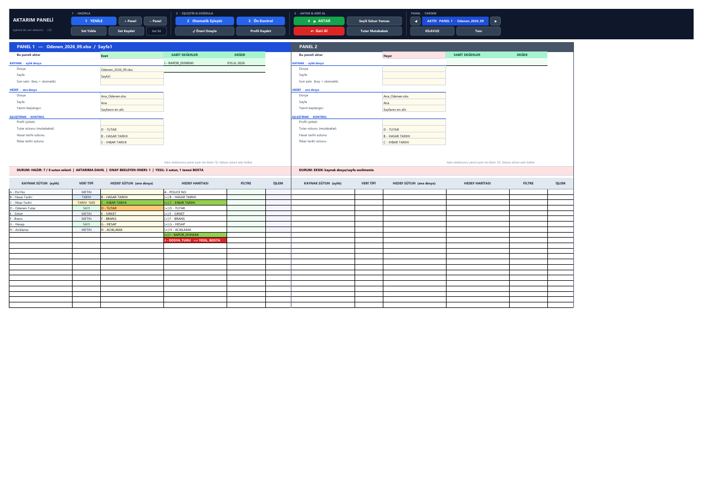

# Aktarım Paneli v35: Veri Aktarım Paneli

An Excel VBA tool for actuarial closing. It copies each month's claim files
(*Ödenen*, *Muallak*, …) into large cumulative master workbooks (870 000+ rows)
**by column mapping**. Every transfer is checked before writing, reconciled
after writing, logged, and reversible.

v34 is a full refactor of v33. The monolithic `Module1/2/3` became nine
single-purpose modules that are edited in VS Code and built into the workbook
with a script. The analytics pages from v33 (Özet, Dosya Durumu, Pivot Kontrol)
were removed. The transfer engine kept all of its behaviour and gained
data-fidelity and safety features.



**Download:** https://furkzel.github.io/pnL/ offers the ready workbook (`.xlsm`),
a macro-free copy (`.xlsx`) and the macros alone (`.zip`), for networks that
block macro files. All three are attached to the
[v35 release](https://github.com/furkzel/pnL/releases/tag/v35) with SHA-256
checksums. Rebuild them with `python tools/release.py`.

---

## Quick start

| Goal | Command |
|---|---|
| Build a fresh workbook | `python tools/build.py --new dist/AktarimPaneli_v34.xlsm` |
| Upgrade a v33 workbook (works on a **copy**; the input is never modified) | `python tools/build.py --upgrade path\to\v33.xlsm --out dist\v33_upgraded.xlsm` |
| Run the end-to-end tests (119 checks) | `python tools/test_e2e.py --v33 path\to\v33.xlsm` |
| Benchmark on large files | `python tools/perf.py --rows 200000 --master 300000` |
| Pull edits made in the VBA editor back into `src/` | `python tools/export.py dist/AktarimPaneli_v34.xlsm` |
| ASCII check only | `python tools/build.py --check` |

Requirements: Windows, Excel, Python 3.10+ with `pywin32`, and in Excel
*File › Options › Trust Center › Macro Settings › "Trust access to the VBA
project object model"*. `tools/screenshot.py` additionally needs `pdftoppm`
(Poppler, TeX Live or MiKTeX) and `Pillow`.

All tools start their **own invisible Excel instance**. They don't touch
workbooks you have open, and a watchdog answers the macros' MsgBox/InputBox
dialogs so automation never hangs.

### Manual installation (without Python)

1. Make a backup of the workbook.
2. `Alt+F11` › remove `Module1`, `Module2`, `Module3`. Also remove any old test
   modules (`TestOrtam`, `OzetTest`, `Yukleyici`, `Resim2`, test `Sozluk`),
   because they call v33 code that no longer exists.
3. *File › Import File…* : `src/Sozluk.cls` and every `src/M0*.bas`.
4. Open the **Panel** sheet's code module and paste in `src/Panel.cls` from
   `Option Explicit` downwards. Do the same with `ThisWorkbook` and
   `src/ThisWorkbook.cls`.
5. *Debug › Compile VBAProject*, then `Alt+F8` › **SifirdanKur** › Run, then save.

`SifirdanKur` keeps Rapor, Gecmis, Profiller and Setler. It moves the panel
to the v34 layout while keeping every setting, fixed value, mapping, filter and
pending suggestion. It deletes the legacy analytics sheets and their `OZ_*`,
`V_*`, `T_*`, `L_*` names, and rebuilds Kılavuz and Geliştirici.

---

## Repository layout

```
src/                     single source of truth (pure ASCII VBA)
  Sozluk.cls             native dictionary (replaces Scripting.Dictionary)
  M01_Ayarlar.bas        constants, enums, layout map, colour palette, globals
  M02_Yardimci.bas       BH/Normalize/TR, SutunOku, file/sheet lookup, data types,
                         BaslikDogrula, menus, AlanTemizle, EkranKilitle/EkranAc
  M03_Panel.bas          block geometry, ribbon, sticky navigation, add/remove panel
  M04_Yenile.bas         Yenile (single-pass sampling), menus, DURUM, fixed values,
                         target map, data-type column, cell-change router
  M05_Eslestirme.bas     auto-mapping, smart suggestion approval, profiles, sets
  M06_Aktarim.bas        transfer engine, filter engine, format guard,
                         formula row shift, patch mode, Ön Kontrol (dry run)
  M07_Kayit.bas          Geri Al (2-phase + fingerprint + backup), Gecmis, Rapor,
                         Tutar Mutabakatı
  M08_Kurulum.bas        SifirdanKur, PaneliYenidenKur (v33 migration), PanelKur, Tani
  M09_Kilavuz.bas        accordion guide (Kılavuz) and developer handoff (Geliştirici)
  Panel.cls              code of the "Panel" sheet (events)
  ThisWorkbook.cls       Workbook_Open: restores Excel state after an aborted macro
tools/                   build.py, export.py, test_e2e.py, perf.py, screenshot.py, xlauto.py
docs/                    screenshots
dist/                    build output (reproducible, git-ignored)
```

Each module states its responsibilities in its header comment. Layout
positions live only in `M01_Ayarlar` (`OFS_*`, `SATIR_*`, `LST_*`, `R_*`, `G_*`,
`P_*`, `ST_*`). There are no magic numbers such as `Cells(i, 8)` or
`Cells(2, 341)` elsewhere.

---

## The Panel screen

**Ribbon**: frozen rows 1–5, so it stays visible when scrolling down. Buttons
are grouped by workflow stage:

| 1 · HAZIRLA | 2 · EŞLEŞTİR & DOĞRULA | 3 · AKTAR & GERİ AL | PANEL · YARDIM |
|---|---|---|---|
| **1 YENİLE**, + Panel, − Panel | **2 Otomatik Eşleştir**, **3 Ön Kontrol** | **4 ▶ AKTAR**, Seçili Sütun Yaması | ◀ *AKTİF: PANEL k* ▶ |
| Set Yükle, Set Kaydet, (small) Set Sil | ✓ Öneri Onayla, Profil Kaydet | **↶ Geri Al**, Tutar Mutabakatı | Kılavuz, Tanı |

v33 had 24 scattered form buttons. v35 has 18. The four numbered primary
buttons are wider and use a larger font, so the 1 → 2 → 3 → 4 path is
visible at a glance. Rarely used macros left the ribbon but still run from
`Alt+F8`: `ProfilSil`, `MenuleriTazele` (already automatic),
`IsaretleriTemizle`, `ButonlariYenile`, `PaneliYenidenKur`.

**Double-click shortcuts.** Double-clicking an orange suggestion approves it.
Double-clicking an İŞLEM cell toggles SEÇ and leaves FORMÜL untouched.

**Auto-detected control columns.** If *Tutar*, *Hasar tarihi* or *İhbar tarihi*
is empty, Yenile fills it when the master has a single clear match (TUTAR /
ÖDENEN / MUALLAK, HASAR + TARİH, İHBAR + TARİH). A value typed by the user or
loaded from a profile or set is never overwritten. DURUM notes the choice.

- **Öneri Onayla is context-aware.** If suggestion rows are selected, only those
  are approved, without a dialog for a single one. Otherwise every suggestion
  in the panel is listed for confirmation.
- **Ön Kontrol** replaces the v33 `Kontrol1..3` buttons. Those wrote criteria
  cells and an AdvancedFilter into the master file. Ön Kontrol runs the whole
  transfer pipeline as a dry run and writes nothing.
- **◀ ▶ navigation and the "AKTİF" indicator** make it obvious which panel
  every button acts on. The ribbon follows horizontal scrolling, and the
  active block's title is highlighted.

**Block** (up to 10 side by side, 6 columns instead of 7):

```
 c+0 KAYNAK SÜTUN | c+1 VERİ TİPİ | c+2 HEDEF SÜTUN | c+3 HEDEF HARİTASI | c+4 FİLTRE | c+5 İŞLEM
 settings: label c, value c+2         SABİT DEĞERLER box: column c+3, value c+4
```

- The settings are grouped into KAYNAK / HEDEF / EŞLEŞTİRME·KONTROL sections.
  "Bu paneli aktar" turns green or red.
- **VERİ TİPİ** sits next to the source column and turns red as `TARIH <> SAYI`
  on a type conflict.
- **İŞLEM** merges the v33 `GERİ AL` and `FORMÜL` flag columns into one
  dropdown: `SEÇ`, `FORMÜL`, `SEÇ + FORMÜL`.
- Header hover notes explain the filter syntax, İŞLEM, the type colours and the
  target map.
- A removed panel is hidden, not deleted. `+ Panel` reuses the hidden block, so
  block numbers and saved sets never shift.

---

## What changed in the engine

### Kept, with behaviour unchanged

The following carry over from v33: multi-panel batches with one *parti* number;
hidden-block reuse; partial filename and numeric/date sheet-name tolerance;
two-pass mapping (exact, then Levenshtein ≥ 0.70 with type filtering); learning
profiles (aliases in `DIGER ADLAR`, deliberately unmapped columns,
non-destructive merge); target map with green-column alerts; the ENGEL/DIKKAT
gate; majority-row and separator-block tail detection; the duplicate-transfer
warning; header re-validation before writing; *Sona ekle*, *Sütunun kendi
sonu* and *Geri alınan aralığa* with row insertion and ledger shifting; and
two-phase undo.

### New in v34

| Area | What it does |
|---|---|
| **Format fidelity** | Excel coerces text written through `Range.Value`: `"0004821"` becomes `4821`, a 19-digit ID becomes `1.23E+18`, and `"=..."` becomes a live formula. `KorumaGerekir` writes these values as text: leading zeros, 16+ digits, formula-like text, and numeric- or date-looking text going into a METİN column. Everything else is written exactly as in v33. New rows inherit the number format of the row above. DIKKAT reports how many cells were protected. |
| **Formula transfer** | Relative **row** references are shifted, and column letters stay as they are. Source row 5 `=B5*C5` becomes target row 870005 `=B870005*C870005`. Each distinct formula pattern is converted once via `ConvertFormula` (`FormulSatirKaydir`). |
| **Filter syntax** | `AXA` · `AXA, ALLIANZ` · `AX*` / `A?A` · `>100`, `<=500`, `>=01.01.2026` · `<>IPTAL` · `BOS` / `DOLU`. If a value itself contains a comma and exists verbatim in the column, it is treated as one value. |
| **Seçili Sütun Yaması** | With *Sayfanın en altı*, columns marked SEÇ overwrite the rows of the **last active transfer** of the same source. Old cell values are saved to a hidden `Yedek` sheet first, and Geri Al restores them. A row-count mismatch is an ENGEL. |
| **Undo fingerprint** | Each Gecmis row stores `IMZA` (non-empty count, sum, first and last value). If rows were inserted or deleted in the master after the transfer, Geri Al shows which ranges no longer match and stops unless the user explicitly confirms. Header mismatch, closed or read-only files, and a missing backup remain hard stops. |
| **Reconciliation** | The completion dialog and Rapor show four figures: *Kaynaktan okunan*, *Hedefe yazılan*, *Hedef önceki / yeni toplam*. It checks `FARK = 0.00` and that the column total grew by exactly the written amount. Sums use `AGGREGATE(9,6)`, which ignores error cells. |
| **Source date checks** | Moved out of the master file. Rows where *ihbar* is before *hasar*, empty dates, unparseable values and text dates are counted (with sample row numbers) on the rows that will actually be transferred. |
| **Fast Yenile** | One read per source column, at most 10 000 rows, gives the data type and the filter candidates. Header and list writes are batched. See the benchmark below. |
| **Native dictionary** | `Sozluk.cls` is backed by `Collection` and replaces all ~40 `CreateObject("Scripting.Dictionary")` calls. There is no COM dependency left. |
| **State guard** | `EkranKilitle`/`EkranAc` with a nesting depth covers ScreenUpdating, EnableEvents, DisplayAlerts and Calculation. `Workbook_Open` and `Tani` restore Excel if a macro was aborted. |

### New in v35: restored and strengthened checkpoints

| Checkpoint | Behaviour |
|---|---|
| Duplicate transfer in Ön Kontrol | The dry run now warns `MUKERRER AKTARIM UYARISI` when the same source is already in the master and not undone. Previously only AKTAR asked. |
| Suspicious tail in Ön Kontrol | The dry run shows what is in the excluded bottom rows, e.g. `203. satir: 447400 \| TOPLAM`. |
| Blank cells in green columns | Rows to be transferred are counted where a mapped mandatory (green) column is empty, with sample row numbers. v34 only caught green columns that were not mapped at all. |
| Amount column integrity | Non-numeric values (`1.200 TL`, `YOK`, errors), blanks and negative amounts are counted with sample rows. These are silently skipped by both the source sum and `AGGREGATE`, so the reconciliation can say TUTUYOR while data is missing. |
| Fixed-value type | A fixed value whose type conflicts with its target column is flagged, e.g. `EYLUL 2026` going into a date column. |
| Readable warning lists | Each item keeps at least 110 characters, up to 10 items are shown, and the rest are summarised as `... ve X madde daha`. Ön Kontrol writes every ENGEL and DIKKAT item unshortened to its own Rapor row and offers to open Rapor. |
| Batch reconciliation | Tutar Mutabakatı re-checks **every** transfer of the last active batch and shows one table, with `>>` marking the panel you are on. |

### v33 bugs fixed along the way

- **Truncated DIKKAT list.** Long DIKKAT lists were cut at MsgBox's 1024-character limit, so later items were never shown, yet the dialog asked *"Maddeleri okudun mu?"*. Every item now starts with an UPPERCASE keyword and is shortened individually, so all items are visible. The full text goes to Rapor.
- **Filter and sheet dropdowns lost their values.** Values such as `0012`, `2026` or `01.09.2026` were coerced when written to the hidden list, so the value picked never matched the source. List columns and the filter and sheet cells are now text-formatted.
- **Appending over a formula.** If the last cell of a column held a formula returning `""`, *Sütunun kendi sonu* restarted writing at row 2 and overwrote data.
- **False type conflict.** Text codes with leading zeros (`0004821`) were typed SAYI, so mapping them to a text column of the master was flagged as a type conflict. They now count as METİN.
- **Whole-sheet clear.** `PanelKur` called `Cells.Clear` on a sheet with dropdowns, which risks XML corruption. It now clears explicit ranges only (`AlanTemizle`).

---

## Verification

`tools/test_e2e.py` drives the built workbook through Excel exactly as a user
would: cell edits fire the sheet events and every dialog is answered and
asserted. **119 / 119 checks pass.** The scenarios are:

1. Yenile, auto-mapping (exact and fuzzy match with a top-3 note), smart approval, profile save and re-apply.
2. Ön Kontrol detects the separated TOPLAM row, `ihbar < hasar`, the format guard and an unfilled green column, and writes nothing.
3. Filters: `ALLIANZ, INC` → 50 rows, `AXA, MAPFRE` → 100, `AL*` → 100, `<>AXA` → 150, `>3000` → 39.
4. Transfer: leading zeros, 19-digit IDs, `=HACK` kept as text, formula row shift, fixed value, inherited formats, exact reconciliation, Gecmis fingerprint.
5. Undo restores the master exactly.
6. Fingerprint: inserting a row above the block triggers a warning and nothing is cleared. After the row is removed, undo works.
7. Patch overwrites one column; undo restores the old values from the backup.
8. Gap mode with 200 rows into a 50-row gap: 150 rows are inserted, data below shifts, and the ledgers stay consistent. Also re-reconciliation, add/remove panel with hidden-block reuse, sets, and rebuilding a v34 panel in place.
9. **Migration of the supplied v33 workbook**: settings, fixed values and mappings of both panels are preserved; legacy sheets and names are removed; Module1/2/3 are removed.

`tools/perf.py`, with a 200 000 × 30 source and a 300 000 × 30 master (3 panels):

| Operation | v34 |
|---|---|
| Yenile (3 panels) | 2.0 s (≈0.7 s/panel; v33 on the same data: 11.8 s for 2 panels ≈ 5.9 s/panel) |
| Otomatik Eşleştir | 0.3 s |
| Ön Kontrol (200 000 rows × 30 cols) | 7.6 s |
| Aktar (200 000 rows × 30 cols, incl. reconciliation) | 25 s |
| Geri Al | 3.6 s |

---

## Rules for maintainers

These rules come from v33 incidents and are also listed on the Geliştirici sheet:

1. The VBA source must be **100 % ASCII**; `build.py` refuses anything else. Text in cells and shapes uses `TR("#s#i")` escapes (`#i #I #s #S #g #G #u #U #o #O #c #C`). MsgBox text stays ASCII.
2. Compare strings with `BH()` / `Normalize()`, never raw `UCase`/`LCase`. On Turkish Windows, `UCase("i")` returns `İ`.
3. No `Scripting.Dictionary`, `RegExp` or ActiveX. Use `Sozluk`, `Collection`, arrays and shape buttons.
4. Read large sheets **column by column** with `SutunOku`. It always returns a 2-D array (a single cell otherwise comes back as a scalar) and falls back to `.Value2` on overflow error 6. Never use `Application.Transpose`.
5. Never call `ws.Cells.Clear` on a sheet with dropdowns; use `AlanTemizle` on explicit ranges.
6. Every entry macro pairs `EkranKilitle` with `EkranAc`, including on its error path. `On Error` statements reset `Err`, so save the error before calling `EkranAc`.
7. Layout changes go in `M01_Ayarlar` only. If the block layout changes, bump `DUZEN_DEGERI` and teach `M08_Kurulum.BlokOku` the old layout so existing panels migrate.
8. After any change, run `build.py` and then `test_e2e.py`. If a fix was made in the VBA editor, run `export.py` and review the diff.

## Known limitations

- Duplicate checks work at file/sheet level, not per policy or claim number.
- Headers must be on row 1. There is no locking, so one user at a time.
- Green-column detection relies on colour (G > R+12 and G > B+12).
- Data type is sampled from 300 rows. Filter dropdowns sample 10 000 rows, but filters are applied to all rows.
